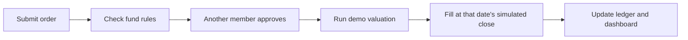

<p align="center">
  <picture>
    <source media="(prefers-color-scheme: dark)" srcset="https://raw.githubusercontent.com/investsync-cuhksz/.github/main/assets/investsync-logo-dark.png">
    
  </picture>
  &nbsp;&nbsp;&nbsp;&nbsp;
  <picture>
    <source media="(prefers-color-scheme: dark)" srcset="https://raw.githubusercontent.com/investsync-cuhksz/.github/main/assets/cuhksz-logo-dark.png">
    
  </picture>
</p>

# Virtual Fund

**Project #1 · InvestSync Technology**

A paper portfolio for the club. Research pitches an investment idea, one committee member proposes a trade, and another decides whether to approve it. The app records what happened and shows how the fund performs against a market benchmark. All money and trades are simulated.

<p>
  
  
  
</p>

> For education within the InvestSync student investment club. No real money or brokerage account is involved.

## What it does

The goal is a track record the club can explain: which ideas led to trades, who approved them, what the fund held afterward, and how those decisions compared with the market. The current **local demo** covers that workflow with a fixed list of five US stocks and USD 1,000,000 in starting capital.

- **Propose and decide:** A committee member enters a buy or sell order with a pitch note and rationale. Another member can approve or reject it. Nobody can approve their own order; the submitter can cancel a pending order.
- **Check the fund rules:** Before accepting an order, the app checks the 10% position limit, 30% sector limit, available cash, and shares available to sell. Pending sells reserve their shares so they cannot be sold twice.
- **Simulate the trade:** An approved order fills when someone runs valuation for an eligible US trading date. It uses that date's simulated closing price, whole shares, and a 0.10% fee.
- **See the result:** The dashboard shows cash, holdings, fund value (NAV), sector weights, and performance against a simulated S&P 500 benchmark. The ledger lists every buy and sell fill. Orders, decisions, fills, and daily snapshots are saved locally.

## How it works



The screens and API are part of one Next.js app. The browser sends orders and decisions to the API; the API applies the rules and stores the results in a local SQLite database. The server, rather than the browser, calculates money and holdings so every screen uses the same figures.

Order size is a percentage of the latest fund value. For a buy, the app works out how many whole shares fit at the closing price when the order fills. For a sell, it fixes and reserves the number of shares when the order is submitted; the eventual proceeds use the fill date's price. A valuation applies eligible approved orders, deducts fees, updates cash and holdings, and saves a daily snapshot for the dashboard. Ledger fills and per-order events are appended rather than edited.

| Term | In this project |
|---|---|
| **Holdings** | The shares the simulated fund currently owns. |
| **NAV** | The fund's total value: cash plus the current value of its holdings. |
| **Benchmark** | A market comparison, currently a simulated S&P 500 series. |

The included closing prices and benchmark levels cover **4 November to 4 December 2026**. A date without demo prices saves nothing, and running the same date twice does not duplicate a fill. Valuation is triggered by hand for now; scheduled jobs and live market data are future work.

## Getting started

You need **Node.js 20.9 or newer** and npm. No API key is required.

```bash
git clone https://github.com/investsync-cuhksz/virtual-fund.git
cd virtual-fund
npm ci
npm run dev
```

Open [http://localhost:3000](http://localhost:3000). The app uses its local API by default; no separate backend server is needed. It creates `data/virtual-fund.sqlite` as you use it. This file is ignored by Git, so a fresh clone starts with the full simulated capital and no past trades. To reset your own demo, stop the app and delete that file. Set `NEXT_PUBLIC_USE_MOCK=true` in a local `.env` file only if you want browser-only sample data instead of the working API.

## Using it

This short walkthrough starts with an empty local database:

1. On **Dashboard**, note the USD 1,000,000 starting cash and no holdings.
2. On **Enter order**, submit a buy order for JNJ at 6% of NAV with a pitch and rationale. The rule checks show whether the order is allowed.
3. Switch to the other committee member on **Orders** and approve it. The order stays approved until valuation runs.
4. On **Valuation**, run the next available demo trading date. The app fills the order and saves the updated fund value.
5. Return to **Dashboard** to see the new holding and reduced cash, then open **Ledger** to see the fill and its pitch note.
6. Submit a smaller JNJ sell, have the other member approve it, and run the following valuation date. The ledger keeps both fills.

The member selector is only for the local demo; it is not a login system.

## Project structure

```text
src/app/          screens and API routes
src/lib/          fund rules, calculations, and demo market data
tests/            API workflow tests
docs/             demo API contract and sample responses
data/             local SQLite database (created when the app runs)
```

The [demo build spec](docs/DEMO_BUILD_SPEC.md) lists the API routes and sample JSON for anyone working on a screen or server feature. The API also exposes each order's submission, decision, and fill history at `GET /api/orders/{id}/events`. Events reconstructed from older local databases are marked `backfilled`.

## Contributing

Contributions can be a small UI improvement, a clearer demo flow, a fund-rule fix, or a test. Keep fund rules and money calculations on the server so every screen sees the same result. Before opening a pull request, run:

```bash
npm run lint
npm run build
npm run test:api
```

The API tests use temporary databases and do not change your local demo. Build before `test:api`, which starts the built app on a temporary port.

## What's next

The demo runs locally with two selectable committee identities. It has no login or shared deployment yet. The next stages are:

- Connect to the club website's login and make the fund available to the committee.
- Make fund settings editable and add Hong Kong and mainland China listings, currency conversion, and board-lot rules.
- Replace the fixed demo prices with a cached market-data source, then schedule valuation after market close.
- Handle dividends, splits, and ledger corrections while preserving the trade history. The current ledger is read-only and contains fills.
