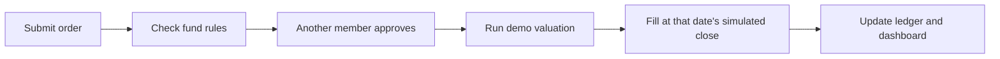

<p align="center">
  <picture>
    <source media="(prefers-color-scheme: dark)" srcset="https://raw.githubusercontent.com/investsync-cuhksz/.github/main/assets/investsync-logo-dark.png">
    
  </picture>
  &nbsp;&nbsp;&nbsp;&nbsp;
  <picture>
    <source media="(prefers-color-scheme: dark)" srcset="https://raw.githubusercontent.com/investsync-cuhksz/.github/main/assets/cuhksz-logo-dark.png">
    
  </picture>
</p>

# Virtual Fund

**Project #1 · InvestSync Technology**

A paper portfolio for the club. One committee member proposes a trade, another decides whether to approve it, and the app records the decision and measures the fund against the market. All money and trades are simulated.

<p>
  
  
  
</p>

> For education within the InvestSync student investment club. No real money or brokerage account is involved.

## What it does

The current **local demo** starts with USD 1,000,000 and five US stocks. A committee member can submit a buy or sell order with a pitch and rationale. Another member must approve it; nobody can approve their own order. The app checks the 10% position limit, 30% sector limit, cash, and shares available to sell. Each fill pays a 0.10% fee.

An approved order fills when someone runs valuation for an eligible US trading date. The dashboard then shows fund value (NAV), cash, holdings, sector weights, and performance against a simulated S&P 500 benchmark. The ledger shows each buy and sell fill. Orders, decisions, fills, and daily fund snapshots are saved locally.

## How it works



The screens and API are part of one Next.js app. The API applies the fund rules and stores results in SQLite; dated closing prices and benchmark levels are included for the demo. Buys use whole shares. Sells reserve a fixed number of whole shares when submitted, so two pending sells cannot use the same shares. A valuation deducts fees and saves a daily snapshot. Ledger fills and per-order events are appended rather than edited.

Demo prices cover **4 November to 4 December 2026**. A date without prices saves nothing, and running the same date twice does not duplicate a fill. This is a manual, local valuation; scheduled jobs and live prices are future work.

## Getting started

You need **Node.js 20.9 or newer** and npm. No API key is required.

```bash
git clone https://github.com/investsync-cuhksz/virtual-fund.git
cd virtual-fund
npm ci
npm run dev
```

Open [http://localhost:3000](http://localhost:3000). The app uses its local API by default. The SQLite file at `data/virtual-fund.sqlite` is ignored by Git; stop the app and delete that file to reset your demo. Set `NEXT_PUBLIC_USE_MOCK=true` in a local `.env` file only to use the browser-only sample data.

## Using it

1. On **Enter order**, submit a buy order for JNJ at 6% with a pitch and rationale.
2. Switch to the other committee member on **Orders** and approve it.
3. On **Valuation**, run the prefilled next demo trading date.
4. Check the holding and fund value on **Dashboard**, then open **Ledger** to see the fill.
5. Submit a sell order for some of those shares, have the other member approve it, and run the next valuation date.

## Project structure

```text
src/app/          screens and API routes
src/lib/          fund rules, calculations, and demo market data
tests/            API workflow tests
docs/             demo API contract and sample responses
data/             local SQLite database (created when the app runs)
```

The [demo build spec](docs/DEMO_BUILD_SPEC.md) lists the API routes and sample JSON. The per-order audit history is available at `GET /api/orders/{id}/events`; events reconstructed from older local databases are marked `backfilled`.

## Contributing

Keep fund rules and money calculations on the server so every screen sees the same result. Before opening a pull request, run:

```bash
npm run lint
npm run build
npm run test:api
```

The API tests use temporary databases and do not change your local demo. Build before `test:api`, which starts the built app on a temporary port.

## What's next

The demo has two selectable committee identities but no login or shared deployment. Planned work includes website login, editable fund settings, Hong Kong and mainland China listings with FX and board lots, an AKShare-backed price cache, scheduled valuation, dividends and splits, and ledger corrections. The current ledger is read-only and contains fills.
